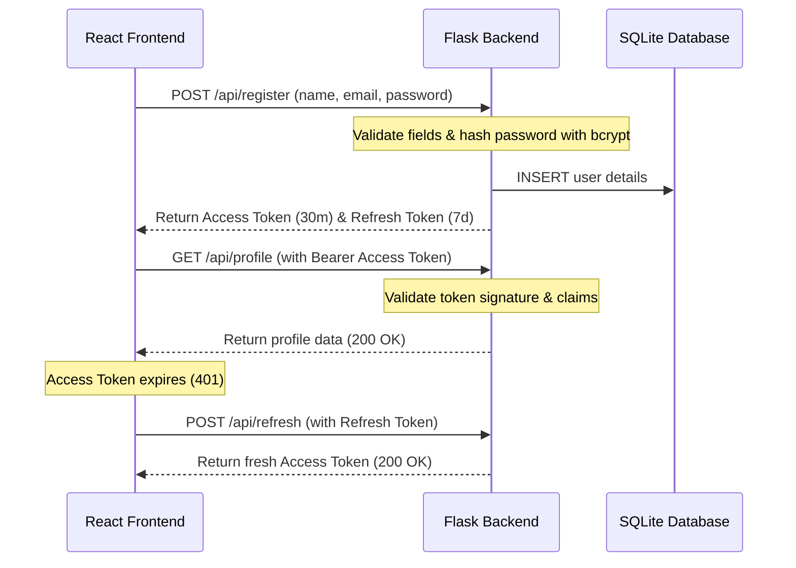

# Secure Web Application Demo

A production-quality full-stack web application demonstrating secure web development practices and defense-in-depth mitigations against the **OWASP Top 10** vulnerabilities. 

Built with **Python Flask** (Backend) and **React.js** (Frontend) using a cybersecurity-themed glassmorphic user interface.

---

## Folder Structure

```
secure-web-app/
├── backend/
│   ├── models/            # SQLAlchemy Models (User, AuditLog)
│   ├── routes/            # Flask API Blueprints (Auth, User Profile)
│   ├── services/          # Business logic & Validation rules
│   ├── middleware/        # Centralized Error Handlers
│   ├── utils/             # Sanitization (bleach) & security headers
│   ├── app.py             # Application factory & setup
│   ├── config.py          # Environment configuration loader
│   ├── extensions.py      # Flask extension singletons
│   ├── requirements.txt   # Backend dependency list
│   └── .env               # Private environment configuration
├── frontend/
│   ├── src/
│   │   ├── api/           # Axios HTTP client with JWT interceptors
│   │   ├── components/    # Reusable UI controls (Pass inputs, badges, avatars)
│   │   ├── context/       # React Context (Auth State, Toast messaging)
│   │   ├── pages/         # Application view templates (Dashboard, Profile, etc.)
│   │   └── utils/         # Client-side input validators
│   ├── index.html         # Main entry point template
│   ├── package.json       # Node package manager configuration
│   └── vite.config.js     # Dev server proxy configuration
└── README.md              # Technical documentation guide
```

---

## Security Features & OWASP Top 10 Mapping

This project explicitly mitigates key security vulnerabilities:

| OWASP Vulnerability | Threat Description | Implementation in Project | Location in Codebase |
| :--- | :--- | :--- | :--- |
| **A01:2021-Broken Access Control** | Accessing unauthorized endpoints or spoofing identifiers. | JWT verification middleware (`@jwt_required`), scoping profile queries directly to JWT context ID. | `backend/routes/user_routes.py` |
| **A02:2021-Cryptographic Failures** | Storing plaintext passwords or using weak hashing algorithms. | Cryptographic hashing of passwords using **bcrypt** with a custom cost factor of 12. Plaintext never stored. | `backend/models/user.py` |
| **A03:2021-Injection** | Exploiting raw SQL queries or input parameters. | Parameterized queries using **SQLAlchemy ORM**. Form inputs sanitized using **Bleach** library. | `backend/utils/security.py`, `backend/models/` |
| **A04:2021-Insecure Design** | Lacking validation checks on client submissions. | Strict validation on both client and server sides (email format checks, password strength policy). | `backend/services/validators.py` |
| **A05:2021-Security Misconfiguration** | Unhardened browsers, missing CORS rules, exposed stack traces. | Enforces strict CORS headers and browser hardening policies (CSP, X-Frame-Options, X-Content-Type-Options, HSTS). Central error handler prevents server stack leaks. | `backend/utils/security.py`, `backend/middleware/` |
| **A07:2021-Identification & Auth Failures** | Brute force guessing, credential stuffing, credential reuse. | Limit access attempts (Max 5 logins before 15 min lockout). Rate limiting on endpoint via `Flask-Limiter`. Separate short-lived JWT access tokens. | `backend/app.py`, `backend/models/user.py` |

---

## How Authentication & JWT Works



1. **Password Protection**: Passwords are hashed dynamically using `Flask-Bcrypt`.
2. **Session Storage Isolation**: If "Remember Me" is selected, JWT keys are stored in `localStorage` for cross-tab persistence. Otherwise, they are kept in transient `sessionStorage` (purged instantly on window closure).
3. **Token Revocation (Blocklist)**: On secure logout, the token JTI is blacklisted in-memory on the backend to prevent reuse before expiration.
4. **Axios Interceptors**: The React frontend interceptor automatically injects the access token and checks responses. If a 401 occurs, it attempts to fetch a fresh token using the refresh endpoint or logs out on failure.

---

## Installation & Run Instructions

### Prerequisites
- Python 3.10+
- Node.js 18+

---

### 1. Backend Setup
Navigate into the `backend/` folder:
```bash
cd backend
```

Create a python virtual environment:
```bash
python -m venv venv
# On Windows:
.\venv\Scripts\activate
# On Unix/macOS:
source venv/bin/activate
```

Install requirements:
```bash
pip install -r requirements.txt
```

Verify `.env` settings:
```bash
cp .env.example .env
```

Start the Flask API server:
```bash
python app.py
```
The server will run on `http://localhost:5000` and automatically initialize the database `secure_app.db` if it doesn't exist.

---

### 2. Frontend Setup
Open a new terminal and navigate into the `frontend/` folder:
```bash
cd frontend
```

Install dependencies:
```bash
npm install
```

Start the Vite development server:
```bash
npm run dev
```
The application will launch at `http://localhost:5173`. Any calls to `/api/*` will be proxied automatically to the backend server.

---

## API Documentation

| Method | Endpoint | Description | Auth Required |
| :--- | :--- | :--- | :--- |
| **POST** | `/api/register` | Create a user profile and return tokens | No |
| **POST** | `/api/login` | Authenticate credentials and return tokens | No (Rate Limited) |
| **POST** | `/api/logout` | Revoke active access tokens (blacklist) | Yes (JWT) |
| **POST** | `/api/refresh` | Issue new access token using refresh token | Yes (Refresh JWT) |
| **GET** | `/api/profile` | Retrieve active profile details | Yes (JWT) |
| **PUT** | `/api/profile` | Update account details (name, email) | Yes (JWT) |
| **PUT** | `/api/change-password` | Update current password with confirmation | Yes (JWT) |
| **GET** | `/api/security-status` | Audits system state compliance score | Yes (JWT) |

---

## Production Deployment Guide

This project is configured for seamless deployment to **Render** (Backend API) and **Vercel** (Frontend Client) matching the structure of the repository: `SyedFaris25/Secure-Web-Application`.

### 1. Backend Deployment (Render)
1. Sign in to [Render](https://render.com) and create a new **Web Service**.
2. Connect your GitHub repository.
3. Configure the following service settings:
   - **Root Directory**: `backend`
   - **Runtime**: `Python 3` (uses the configuration in `runtime.txt` automatically)
   - **Build Command**: `pip install -r requirements.txt`
   - **Start Command**: `gunicorn app:app` (Procfile configures this automatically)
4. Add the following **Environment Variables** in Render:
   - `FLASK_ENV`: `production`
   - `SECRET_KEY`: *[A long, secure random key]*
   - `JWT_SECRET_KEY`: *[A different secure random key]*
   - `DATABASE_URL`: *[Optional postgres connection URI; defaults to sqlite:///users.db]*
   - `CORS_ORIGINS`: `https://[your-vercel-domain].vercel.app`

### 2. Frontend Deployment (Vercel)
1. Sign in to [Vercel](https://vercel.com) and import a new project.
2. Select your GitHub repository.
3. Configure the following project settings:
   - **Root Directory**: `frontend`
   - **Framework Preset**: `Vite` (Vercel automatically detects this)
   - **Build Command**: `npm run build`
   - **Output Directory**: `dist`
4. Add the following **Environment Variables** in Vercel:
   - `VITE_API_URL`: `https://[your-render-backend-url].onrender.com` (Ensure it has no trailing slash)
5. Vercel automatically deploys the frontend and routes requests using `vercel.json` SPA rewrite rules.

